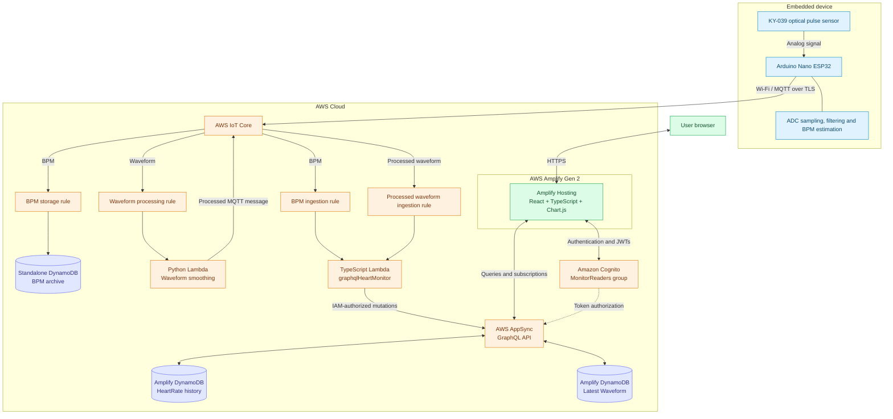

# Heart Monitor | Embedded IoT & AWS Cloud

An end-to-end IoT prototype that captures an optical pulse signal on an Arduino Nano ESP32, estimates heart rate on the device, processes waveform snapshots in the cloud and visualizes the results in an authenticated web dashboard.

The project combines embedded C++, digital signal processing, secure MQTT communication, serverless cloud services and real-time web development. Its purpose is to demonstrate the complete journey from a physical sensor to a cloud-connected application.

## Dashboard

<!-- Replace the placeholder below with:  -->


> The dashboard displays current BPM, average BPM, the latest five-second optical pulse waveform and recent heart rate history.

## System architecture



## How it works

### 1. Embedded acquisition and signal processing

The KY-039 sensor uses infrared light to detect changes in blood volume in a fingertip. The resulting analog signal is sampled by the ESP32 at 100 Hz.

The firmware uses ADC oversampling, exponential baseline removal and low-pass filtering to reduce noise and isolate the pulsatile component. A threshold-based peak detector identifies individual beats, with interval limits to reject implausible detections. Heart rate is calculated from the average of up to ten valid beat intervals:

$$
\mathrm{BPM} = \frac{60\,000}{\overline{T}_{\mathrm{beat}}\;(\mathrm{ms})}
$$

Separate FreeRTOS tasks handle sensor acquisition and network communication, reducing interference from network delays. A circular buffer retains the latest 500 waveform samples, and queues transfer snapshots and BPM readings between tasks.

### 2. Secure device-to-cloud communication

The ESP32 connects to AWS IoT Core using MQTT over TLS with X.509 device certificates. BPM and waveform data are published independently, allowing each stream to be processed according to its requirements.

| MQTT topic | Payload | Interval |
| --- | --- | --- |
| `heartmonitor/HeartMonitor01/bpm` | BPM, validity and device metadata | 5 seconds |
| `heartmonitor/HeartMonitor01/waveform` | 500 samples at 100 Hz | 10 seconds |
| `heartmonitor/HeartMonitor01/processed` | Smoothed waveform and timestamp | After cloud processing |

### 3. Serverless processing and storage

AWS IoT Rules route incoming messages to the appropriate services. BPM readings are written to a standalone DynamoDB table for historical storage. Waveform snapshots invoke a Python Lambda function that applies a centered nine-sample moving-average filter and publishes the processed signal back to IoT Core.

A second Lambda function, `graphqlHeartMonitor`, validates incoming BPM and processed waveform messages and writes them through the AppSync GraphQL API using IAM authorization. Amplify-managed DynamoDB tables store BPM history and the latest waveform per device.

Using GraphQL mutations rather than direct database writes for the dashboard data allows AppSync subscriptions to notify connected clients of changes.

### 4. Real-time web dashboard

The frontend is built with React, TypeScript, Vite and Chart.js, and deployed using AWS Amplify Hosting. It retrieves recent measurements through GraphQL queries and receives updates through subscriptions without requiring a manual page refresh.

- Current heart rate and average of displayed valid measurements
- Latest five-second optical pulse waveform (500 samples)
- Recent BPM history: up to 120 readings, approximately ten minutes at the configured interval
- Invalid measurement and stale-data indicators
- Cognito-based sign-in and group-restricted data access

## Technology stack

| Layer | Technologies |
| --- | --- |
| Hardware | Arduino Nano ESP32, KY-039 optical pulse sensor |
| Firmware | C++, Arduino framework, FreeRTOS, ADC, ArduinoJson |
| Communication | Wi-Fi, MQTT, TLS, X.509 certificates |
| Cloud ingestion | AWS IoT Core, IoT Rules |
| Cloud compute | AWS Lambda (Python and TypeScript) |
| Storage | Amazon DynamoDB |
| API and live updates | AWS AppSync, GraphQL subscriptions |
| Authentication | Amazon Cognito, IAM |
| Frontend | React, TypeScript, Vite, Chart.js |
| Deployment | AWS Amplify Gen 2, Git-based CI/CD |

## Repository structure

```text
amplify/
├── auth/resource.ts                  # Cognito configuration
├── data/resource.ts                  # GraphQL schema and authorization
├── functions/graphqlHeartMonitor/    # Telemetry ingestion Lambda
└── backend.ts                        # Backend resource definitions
src/
├── App.tsx                           # Dashboard and live data subscriptions
├── App.css                           # Dashboard styling
├── configure.ts                      # Amplify configuration
└── main.tsx                          # Application entry and authentication
amplify.yml                           # Cloud build and deployment pipeline
```

The ESP32 firmware and Python waveform-processing Lambda are separate components of the system. The structure above describes the Amplify application repository.

## Getting started

### Local development

Install dependencies using the project's committed lock file:

```bash
npm ci
```

Generate the Amplify configuration for an existing deployment:

```bash
npx ampx generate outputs --app-id YOUR_APP_ID --branch main
npm run dev
```

Alternatively, use `npx ampx sandbox` to provision a separate development backend. Configure the IoT rules to target the backend you intend to use.

### Cloud deployment

1. Configure the ESP32 Wi-Fi credentials, IoT endpoint and device certificates locally.
2. Create the IoT Thing, restricted device policy, standalone BPM table and waveform-processing Lambda.
3. Connect the repository to AWS Amplify Hosting and deploy using the included `amplify.yml`.
4. Register a user and add that user to the Cognito `MonitorReaders` group; sign out and back in.
5. Configure the BPM and processed-waveform IoT Rules to invoke the deployed `graphqlHeartMonitor` Lambda. Grant IoT Core invocation permission and the processing Lambda permission to publish to the processed topic.

BPM ingestion rule (AWS IoT SQL 2016-03-23):

```sql
SELECT *, 'bpm' AS messageType, timestamp() AS timestamp
FROM 'heartmonitor/HeartMonitor01/bpm'
```

Processed waveform ingestion rule:

```sql
SELECT *, 'waveform' AS messageType
FROM 'heartmonitor/HeartMonitor01/processed'
```

## Security and design considerations

Device authentication and user authentication are independent: the ESP32 uses X.509 certificates, while web users authenticate through Cognito. Only members of `MonitorReaders` can read the dashboard data, and the ingestion Lambda uses IAM-authorized GraphQL operations. No permanent AWS credentials or device private keys belong in the frontend or source repository.

The design separates time-sensitive acquisition from cloud processing and visualization. Only the latest waveform is retained in the dashboard database to limit waveform storage. BPM history is currently duplicated in the standalone and Amplify-managed tables; automatic retention is not configured. The prototype is designed for a single device and does not guarantee delivery of every MQTT message.

## Future improvements

- Adaptive peak detection and signal-quality estimation
- Configurable history ranges and automatic data retention
- Multi-device support with per-device authorization
- Automated firmware and backend tests, and cloud monitoring
- Evaluation against a reference pulse sensor

## Disclaimer

This is an educational engineering prototype, not a medical device. The waveform is an optical photoplethysmography (PPG) signal, not an ECG. Measurements have not been clinically validated and must not be used for medical decisions.
