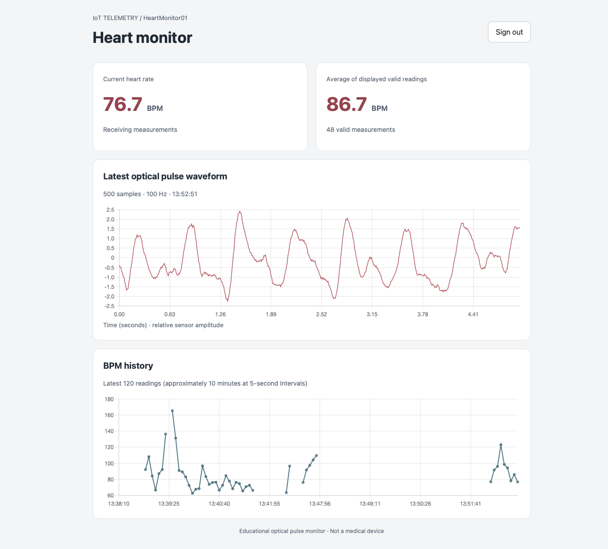
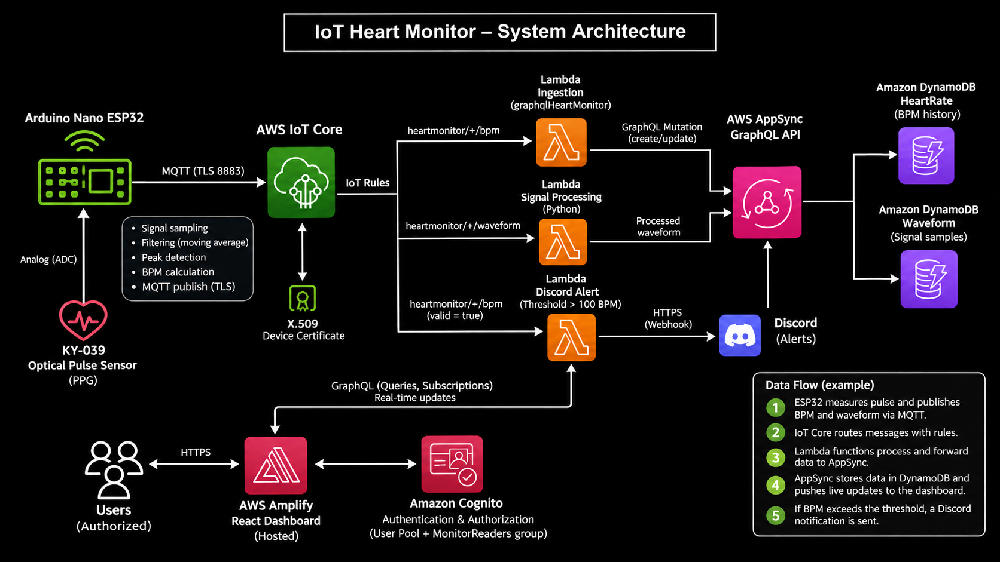

# Heart Monitor | Embedded IoT & AWS Cloud

## About the project

An end-to-end IoT system that captures an optical pulse signal using an Arduino Nano ESP32, estimates heart rate on the device, processes waveform snapshots in the cloud and visualizes the results in an authenticated web dashboard.

The project combines embedded C++, digital signal processing, secure MQTT communication, serverless cloud services and real-time web development.

The objective is to demonstrate how a physical sensor can be integrated into a secure, scalable and event-driven cloud architecture, providing remote monitoring, historical data visualization and automated notifications through Discord.

## Dashboard



The dashboard provides:

- Current heart rate in beats per minute (BPM).
- Average heart rate.
- Real-time visualization of the optical pulse waveform.
- Historical heart rate measurements.
- Invalid measurement and stale-data indicators.
- Secure user authentication.

The dashboard receives updates automatically without requiring the user to refresh the page.

## System architecture

<!-- Insert the new system architecture diagram here. -->



The system is divided into four main layers:

- **Embedded layer:** Sensor acquisition, digital signal processing and heart rate estimation.
- **Communication layer:** Secure MQTT communication between the ESP32 and AWS IoT Core.
- **Cloud layer:** Serverless processing, data storage, API services and automated notifications.
- **Presentation layer:** An authenticated web dashboard and Discord notifications.

## Use case and requirements

### Purpose

The purpose of the project is to develop a cloud-connected monitoring system that enables users to remotely observe heart rate measurements and receive automated notifications when a configured threshold is exceeded.

The system demonstrates how embedded devices, cloud infrastructure and external communication services can be integrated into a single IoT solution.

### Functional requirements

- Acquire an optical pulse signal using the KY-039 sensor.
- Process the acquired signal and estimate heart rate on the ESP32.
- Transmit BPM measurements and waveform snapshots to AWS.
- Perform additional waveform processing in the cloud.
- Store historical heart rate measurements in DynamoDB.
- Visualize current and historical measurements through a web dashboard.
- Provide automatic dashboard updates.
- Restrict data access to authorized users.
- Generate Discord notifications when the configured heart rate threshold is exceeded.

### Non-functional requirements

- Secure and encrypted communication.
- Device and user authentication.
- Access control based on assigned permissions.
- Scalable, serverless cloud architecture.
- Separation of sensor acquisition and network communication.
- Near-real-time data visualization.
- Handling of invalid sensor measurements and communication interruptions.

## Technology stack

| Layer | Technologies |
| --- | --- |
| Hardware | Arduino Nano ESP32, KY-039 optical pulse sensor |
| Firmware | C++, Arduino framework, FreeRTOS, ArduinoJson |
| Signal processing | ADC oversampling, digital filtering, peak detection |
| Communication | Wi-Fi, MQTT, TLS, X.509 certificates |
| Cloud ingestion | AWS IoT Core, AWS IoT Rules |
| Cloud computing | AWS Lambda, Python, TypeScript |
| Data storage | Amazon DynamoDB |
| API and live updates | AWS AppSync, GraphQL subscriptions |
| Authentication | Amazon Cognito |
| Authorization | AWS IAM, AWS IoT policies |
| Logging and diagnostics | Amazon CloudWatch, Serial Monitor |
| Frontend | React, TypeScript, Vite, Chart.js |
| Deployment | AWS Amplify Gen 2, Git-based CI/CD |
| Notifications | Discord Webhooks, HTTPS |
| Version control | Git, GitHub |

## How the system works

### 1. Embedded acquisition and signal processing

The KY-039 sensor uses infrared light to detect changes in blood volume in a fingertip. This measurement technique is known as photoplethysmography (PPG).

The resulting analog signal is sampled by the ESP32 at a frequency of 100 Hz.

The firmware implements several signal-processing techniques:

- ADC oversampling to reduce measurement noise.
- Exponential baseline removal to isolate the pulsatile component.
- Low-pass filtering to attenuate high-frequency noise.
- Threshold-based peak detection to identify individual heartbeats.
- Beat interval validation to reject implausible detections.
- Moving average of up to ten valid beat intervals.

Heart rate is calculated using the average interval between detected heartbeats:

$$
\mathrm{BPM} = \frac{60\,000}{\overline{T}_{\mathrm{beat}}}
$$

Where the average beat interval is expressed in milliseconds.

### FreeRTOS and concurrent execution

The firmware uses separate FreeRTOS tasks for sensor acquisition and network communication.

This separation reduces interference from network delays and allows signal acquisition to continue independently of MQTT communication.

A circular buffer retains the latest 500 waveform samples, corresponding to five seconds of signal data. FreeRTOS queues are used to transfer measurements and waveform snapshots between tasks.

### 2. Device-to-cloud communication

The ESP32 connects to Wi-Fi and establishes an encrypted MQTT connection to AWS IoT Core.

Device authentication is performed using X.509 certificates.

BPM measurements and waveform snapshots are published independently, allowing the cloud infrastructure to process each data stream according to its requirements.

| MQTT topic | Payload | Publishing interval |
| --- | --- | --- |
| `heartmonitor/HeartMonitor01/bpm` | BPM and device metadata | 5 seconds |
| `heartmonitor/HeartMonitor01/waveform` | 500 samples at 100 Hz | 10 seconds |
| `heartmonitor/HeartMonitor01/processed` | Smoothed waveform | After cloud processing |

Example BPM message:

```json
{
    "deviceId": "HeartMonitor01",
    "bpm": 74.8,
    "uptimeMs": 15000,
    "valid": true
}
```

The separation of BPM and waveform messages allows numerical measurements to be stored and evaluated independently of the larger waveform payloads.

### 3. Serverless cloud processing

AWS IoT Rules route incoming MQTT messages to different cloud services depending on their topic and purpose.

#### Waveform processing

Waveform snapshots invoke a Python-based AWS Lambda function.

The function applies a centered nine-sample moving-average filter to further reduce noise in the optical pulse signal.

The processed waveform is then published back to AWS IoT Core on the processed waveform topic.

This separates time-sensitive embedded processing from additional cloud-based signal processing.

#### GraphQL data ingestion

A TypeScript-based Lambda function, `graphqlHeartMonitor`, receives BPM measurements and processed waveform messages through AWS IoT Rules.

The function validates incoming data and performs IAM-authorized GraphQL mutations through AWS AppSync.

AppSync subsequently stores the data in DynamoDB.

Using GraphQL mutations rather than direct database writes enables AppSync subscriptions to notify connected dashboard clients when new measurements become available.

### 4. Data storage

Amazon DynamoDB is used as the persistent storage layer.

The system currently uses three tables:

| Table | Purpose |
| --- | --- |
| Standalone BPM table | Independent archive of heart rate measurements |
| Amplify HeartRate table | Historical BPM measurements used by the dashboard |
| Amplify Waveform table | Latest processed waveform for each device |

The Amplify-managed tables are automatically provisioned from the application's data models.

Historical BPM measurements are retained, while only the latest waveform snapshot is stored per device in the dashboard database. This limits the storage requirements associated with waveform data.

The standalone BPM archive operates independently of the dashboard. Consequently, BPM measurements are currently stored in two separate tables.

### 5. Real-time web application

The web application is built using React, TypeScript, Vite and Chart.js and is deployed through AWS Amplify Hosting.

AWS AppSync provides a GraphQL API between the frontend and DynamoDB.

The application retrieves existing measurements through GraphQL queries and receives subsequent changes through subscriptions.

This enables the dashboard to update automatically when new measurements arrive.

The application displays:

- Current heart rate.
- Average of displayed valid heart rate measurements.
- Latest five-second optical pulse waveform.
- Up to 120 recent BPM readings, corresponding to approximately ten minutes of measurements.
- Measurement validity and stale-data indicators.

Amazon Cognito handles user authentication, while group-based authorization restricts access to the monitoring data.

## Discord integration

The system includes a dedicated notification service based on AWS Lambda and Discord Webhooks.

The purpose of the integration is to allow users to receive threshold-based notifications without having to continuously monitor the web dashboard.

### Notification workflow

1. The ESP32 publishes a BPM measurement to AWS IoT Core.
2. An IoT Rule forwards valid measurements to the `HeartMonitorDiscordAlert` Lambda function.
3. Lambda evaluates the measured BPM against a configurable threshold.
4. If the threshold is exceeded, Lambda constructs a structured notification.
5. The notification is sent to a dedicated Discord channel using an HTTPS POST request.

The notification contains:

- Device identifier.
- Measured heart rate.
- Configured threshold.
- Timestamp.
- Alert description.

### Configuration

The notification service uses Lambda environment variables.

| Environment variable | Description |
| --- | --- |
| `DISCORD_WEBHOOK_URL` | Secret Discord webhook endpoint |
| `BPM_THRESHOLD` | Heart rate threshold for notifications |

The threshold can be changed without modifying the ESP32 firmware or redeploying the web application.

The webhook integration does not require a continuously running Discord bot or a dedicated server.

### Independent event processing

The Discord notification service operates independently of the waveform-processing and dashboard-ingestion functions.

This separation ensures that notification processing is not part of the normal data storage path.

The basic threshold-based implementation evaluates each incoming valid measurement independently. Repeated measurements above the threshold may therefore generate repeated notifications.

The threshold is intended for demonstrating event-driven notifications and is not a clinically validated medical alarm threshold.

## Scalability

The system is based on a serverless AWS architecture, allowing the cloud infrastructure to accommodate increasing workloads without requiring manually administered servers.

### Scalable infrastructure

- **AWS IoT Core:** Supports MQTT communication from multiple connected IoT devices.
- **AWS Lambda:** Automatically scales execution according to incoming requests, subject to service quotas and concurrency limits.
- **Amazon DynamoDB:** Provides scalable NoSQL storage for historical measurements and device-specific data.
- **AWS AppSync:** Provides managed GraphQL APIs and real-time subscriptions.
- **AWS Amplify:** Provides managed hosting and deployment of the web application.
- **Independent data streams:** BPM measurements and waveform snapshots can be processed separately.
- **Configurable publishing intervals:** Firmware publishing intervals can be adjusted to balance network traffic, processing requirements and cloud costs.

### Estimated message volumes

Each device publishes a BPM measurement every five seconds and a waveform snapshot every ten seconds.

This results in:

- 12 BPM messages per minute.
- 6 waveform messages per minute.
- 18 device-originated MQTT messages per minute.
- 25,920 device-originated MQTT messages per day.

| Number of devices | BPM messages/day | Waveform messages/day | Total messages/day |
| ---: | ---: | ---: | ---: |
| 1 | 17,280 | 8,640 | 25,920 |
| 10 | 172,800 | 86,400 | 259,200 |
| 100 | 1,728,000 | 864,000 | 2,592,000 |
| 1,000 | 17,280,000 | 8,640,000 | 25,920,000 |
| 10,000 | 172,800,000 | 86,400,000 | 259,200,000 |

These figures represent theoretical device-originated message volumes under continuous operation. They do not include additional MQTT messages generated by cloud-based waveform processing, database operations or GraphQL subscription events.

### Scalability considerations

Larger deployments require consideration of:

- AWS service quotas and Lambda concurrency limits.
- MQTT message volumes and payload sizes.
- DynamoDB read and write capacity.
- Historical data retention and storage costs.
- AppSync subscription capacity.
- Discord API rate limits.
- Unique device identities and certificates.
- Device-specific authorization and topic routing.

Although the underlying cloud services support horizontal scaling, the current prototype is configured for a single device.

The architecture has not been load-tested with hundreds or thousands of connected devices. The figures above illustrate potential workloads rather than verified system capacity.

## IoT security

Security is an important part of the architecture, covering device communication, cloud resources, user authentication and external service integration.

### Secure communication

The ESP32 communicates with AWS IoT Core using MQTT over TLS on port 8883.

TLS provides encrypted communication and protects transmitted measurements against unauthorized interception.

Communication between the web application and AWS services uses HTTPS and secure WebSocket connections.

Discord notifications are also transmitted over HTTPS.

### Certificate-based device authentication

The ESP32 uses X.509 certificate-based authentication when connecting to AWS IoT Core.

The device is configured with:

- A device certificate.
- A private key.
- An AWS root CA certificate.

The root CA certificate is used to verify the server's identity, while the device certificate and private key authenticate the ESP32.

This provides device authentication independently of the web application's user authentication.

### AWS IoT policies

A restricted AWS IoT policy controls the MQTT operations permitted for the device.

The policy restricts the device to its assigned MQTT client identity and authorized publishing topics.

This follows the principle of least privilege by limiting access to resources required for normal device operation.

### User authentication and authorization

Amazon Cognito handles user registration and authentication for the web application.

Authenticated users receive tokens that are used when accessing the GraphQL API.

Access to monitoring data is restricted to members of the `MonitorReaders` Cognito group.

This separates user authentication from device authentication and prevents unauthorized users from reading monitoring data through the dashboard API.

### AWS IAM

AWS Identity and Access Management controls permissions between cloud services.

IAM permissions are used for operations such as:

- Invoking Lambda functions from AWS IoT Rules.
- Publishing processed waveform messages to AWS IoT Core.
- Writing measurements to DynamoDB.
- Performing authorized GraphQL operations.

Each component should only have the permissions required to perform its assigned responsibility.

### Credential and webhook protection

Device private keys, Wi-Fi credentials and Discord webhook URLs must not be committed to the public source repository.

The Discord webhook URL is stored in a Lambda environment variable rather than being embedded directly in the application source code.

Since the webhook URL contains an authentication token, anyone possessing it could potentially send messages to the associated Discord channel.

Secret webhook URLs and device credentials must therefore be excluded from application logs and public documentation.

### Measurement validation and communication handling

The system incorporates several mechanisms to improve reliability:

- Beat interval validation.
- Invalid measurement indicators.
- Automatic network reconnection attempts.
- Separation of network communication from sensor acquisition.
- A five-second HTTP request timeout for Discord notifications.
- Independent cloud processing functions.

These mechanisms help reduce the impact of invalid measurements and communication interruptions.

### Security overview

| Security mechanism | Purpose |
| --- | --- |
| MQTT over TLS | Encrypted device-to-cloud communication |
| X.509 certificates | Device authentication |
| AWS IoT policies | Restricted MQTT access |
| Amazon Cognito | User authentication |
| Cognito groups | Dashboard data authorization |
| AWS IAM | Cloud service permissions |
| HTTPS and secure WebSockets | Secure application communication |
| Lambda environment variables | Separation of webhook credentials from source code |
| Measurement validation | Filtering of invalid measurements |
| HTTP timeout | Limiting external request duration |

## Comparison of visualization methods

IoT measurements can be presented through different visualization and notification platforms depending on the requirements of the application.

| Platform | Advantages | Limitations |
| --- | --- | --- |
| AWS Amplify and React | Customizable interface, authentication and real-time visualization | Requires frontend development and maintenance |
| Grafana | Advanced time-series visualization and monitoring | Requires additional data-source integration |
| Amazon QuickSight | Interactive reporting and analytical capabilities | Additional configuration and potential costs |
| Discord | Automated notifications without opening a dashboard | Limited historical analysis and visualization |

### Selected visualization approach

The project combines a custom React dashboard with Discord notifications.

The dashboard provides detailed visualization of current and historical measurements, while Discord provides event-driven notifications when a configured threshold is exceeded.

This combination supports both continuous monitoring and asynchronous notifications.

Grafana and Amazon QuickSight are included for comparison and are not implemented as part of the current system.

## Repository structure

```text
amplify/
├── auth/resource.ts
├── data/resource.ts
├── functions/graphqlHeartMonitor/
└── backend.ts

src/
├── App.tsx
├── App.css
├── configure.ts
└── main.tsx

amplify.yml
package.json
README.md
```

The repository contains the Amplify application, including frontend components, authentication configuration, data models and the telemetry-ingestion Lambda.

The ESP32 firmware, Python waveform-processing Lambda and Discord notification Lambda are separate system components.

## Getting started

### Local development

Install dependencies:

```bash
npm ci
```

Generate the Amplify configuration for an existing deployment:

```bash
npx ampx generate outputs --app-id YOUR_APP_ID --branch main
```

Start the development server:

```bash
npm run dev
```

Alternatively, a separate development backend can be provisioned using:

```bash
npx ampx sandbox
```

### Cloud deployment

1. Configure the ESP32 Wi-Fi credentials, AWS IoT endpoint and device certificates.
2. Create the AWS IoT Thing and restricted device policy.
3. Configure the standalone BPM storage table and waveform-processing Lambda.
4. Connect the GitHub repository to AWS Amplify Hosting.
5. Deploy the application using the included `amplify.yml`.
6. Register a user and assign the user to the `MonitorReaders` Cognito group.
7. Configure the BPM and processed-waveform ingestion rules.
8. Create a Discord webhook and configure the notification Lambda.
9. Configure the Discord notification IoT Rule.

### BPM ingestion rule

```sql
SELECT *, 'bpm' AS messageType, timestamp() AS timestamp
FROM 'heartmonitor/HeartMonitor01/bpm'
```

### Processed waveform ingestion rule

```sql
SELECT *, 'waveform' AS messageType
FROM 'heartmonitor/HeartMonitor01/processed'
```

### Discord notification rule

```sql
SELECT *
FROM 'heartmonitor/HeartMonitor01/bpm'
WHERE valid = true
```

The Discord notification threshold is evaluated by the Lambda function rather than the IoT Rule, allowing it to be configured through environment variables.

## System limitations

The current implementation is an educational IoT prototype configured for a single device.

- Optical measurements are sensitive to finger placement, movement and ambient light.
- Heart rate estimation depends on threshold-based peak detection.
- MQTT communication does not guarantee delivery of every measurement.
- Historical BPM measurements are currently duplicated across two databases.
- Automatic historical data retention is not configured.
- Large-scale deployment capacity has not been experimentally verified.
- Threshold-based Discord notifications may be repeated while measurements remain above the threshold.

## Disclaimer

This project is an educational engineering prototype and is not a medical device.

The displayed waveform is an optical photoplethysmography (PPG) signal, not an electrocardiogram (ECG).

Measurements and notifications have not been clinically validated and must not be used for medical diagnosis, treatment or emergency monitoring.